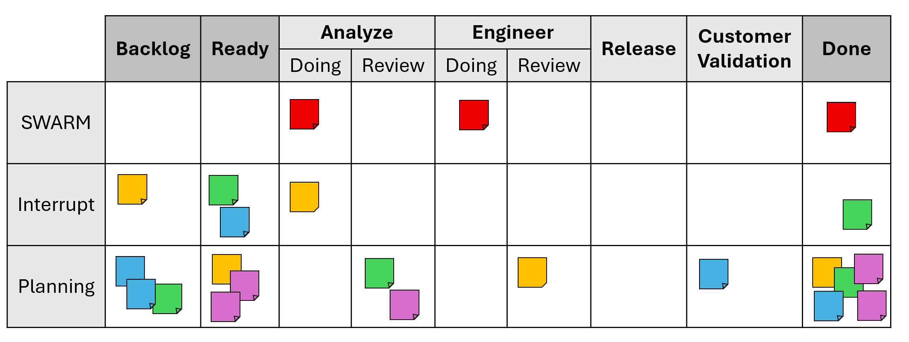

# Workflow and Board Anatomy

## Summary

Keep the board current so anyone can see what matters now, what's blocked, and where to help. A wall
of sticky notes works as well as a digital board if the whole team can see it and keep it up to
date.

## Board Concept

Tickets move from left to right as the team designs, builds, releases, and validates a change.
Horizontal rails keep urgent and unexpected work visible alongside planned work.

## Board Diagram

## Columns

Start with these columns. Rename them if it helps your team. If you add a column, agree on when a
ticket enters and leaves it.

1. Backlog: work the team might do but hasn't committed to yet. Some items still need details.
2. Ready: the highest-priority work that is clear enough to start. The coach usually replenishes
   this column from the backlog.
3. Analyze: the shepherd prepares or updates the design doc, clarifies assumptions, and obtains peer
   signoff.
4. Engineer: implementation, tests, and instrumentation are completed and reviewed.
5. Release: the change is merged and deployed, with rollout and monitoring handled as needed.
6. Customer Validation: the stakeholder or user checks that the change solves the intended problem.
7. Done: the ticket meets the team's definition of done, and the team has recorded anything worth
   keeping.

### Column Exit Criteria

Agree on what must be true before a ticket can leave each column.

- Backlog
    - the team agrees the item is worth keeping visible
    - acceptance criteria are defined well enough to support prioritization
- Ready
    - a shepherd is identified
    - the work is small enough and clear enough to start
- Analyze
    - the design document exists
    - at least two peers have signed off on the current approach
- Engineer
    - required tests pass
    - the pull request has at least two approvals
- Release
    - the change has passed the relevant acceptance checks
    - it has been integrated and released through the normal path
    - monitoring or observability checks are complete
- Customer Validation
    - the customer or stakeholder has validated the outcome, or follow-up work has been created
- Done
    - the ticket is actually closed and any important learning is available for retrospective review

Your release and validation steps may look different. Whatever checks you agree on, finish them
before moving the ticket.

## Rails

Rails, also called swimlanes, separate work by urgency or type.

- Swarm: urgent customer-impacting issues that justify shared attention. Target turnaround is often
  under one business day.
- Interrupt: unexpected but important work that cannot wait for the normal queue, such as a
  compliance request or a time-sensitive demo ask.
- Planned: the normal stream of intentionally prioritized work.

Optional rails may also be useful:

- Time Off: used to make capacity changes explicit.
- Tracking: work that's mostly waiting on someone outside the team. If too many tickets end up here,
  it's easy to lose track of what's blocked.
- Lead or Manager: used when certain role-specific tasks would otherwise distort normal WIP and flow
  expectations.

Before adding a rail, ask who will use it and what it will help them see.

## Flow Example

1. A backlog item is refined during planning and moved into Ready.
2. An engineer pulls it into Analyze, drafts the design document, and gets peer signoff.
3. The ticket moves into Engineer for implementation, testing, and review.
4. The change is released and monitored.
5. The customer or stakeholder validates the result, and the ticket moves to Done.

If a ticket stalls or moves backward, leave that visible on the board.

## Backward Movement Policy

Tickets should rarely move backward.

Record backward moves and discuss them at the next retrospective. If a ticket moved from Release
back to Engineer, ask what the team could have caught earlier.

## Navigation

[← Step 2: Principles](principles.md) | [Step 4: Roles & Responsibilities →](roles.md)
