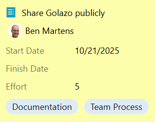

# Tickets and Sizing

## Summary

A ticket covers one outcome the team can plan, build, release, and validate within its agreed time
limit (SLA). For many teams that's less than two weeks. Small tickets are easier to review and let
you get feedback before committing to the rest of a feature.

## Ticket Definition

Can you review, release, and validate this change on its own? If it depends on several other
unfinished changes, look for a smaller piece to deliver first. Write acceptance criteria and note
what tests, monitoring, and documentation the ticket needs before it's done.

## Core Fields

| Field               | Purpose                                             | Notes                                           |
| ------------------- | --------------------------------------------------- | ----------------------------------------------- |
| Title               | States the outcome in concrete terms                | Avoid vague verbs and generic cleanup language  |
| Shepherd            | Keeps the ticket moving                             | Can share the implementation with others        |
| Acceptance Criteria | Defines what success looks like                     | Should exist before major implementation starts |
| Cost Estimate       | Estimates effort, using a relative size or time     | Helps spot tickets that may need splitting      |
| Start / End Dates   | Records actual timing for review and retrospective  | Helps with cycle-time analysis                  |
| Tags / Color        | Associates the ticket with a workstream or category | Keep this simple enough to stay readable        |

## Example

## Colors

Use a few colors to make the major workstreams easy to spot.

- See whether most active tickets belong to the same workstream.
- Notice when no tickets in an important workstream are moving.
- Use the colors in retrospectives to see where the team spent its time.

## Ticket Readiness

Before work starts, all of the following should be true:

- the ticket delivers a standalone outcome that someone can validate
- it fits within the team SLA
- the acceptance criteria and definition of done are concrete enough to verify
- the design complexity is understood well enough that the work is not mostly discovery

If one of these is missing, split the ticket or create a spike first.

## Spike Tickets

Use a spike when you need an answer before you can write acceptance criteria. For example, test
whether an unfamiliar API can handle the operation the ticket requires.

Characteristics of a good spike:

- it answers a specific set of questions
- it produces documented findings and follow-up tickets
- it is time-boxed, usually to a few days or less
- it ends with a decision or a clearer next step

Keep the spike focused on finding an answer. Open a separate ticket for implementation.

## Anti‑Patterns

- Tickets that are really small projects
- Titles such as "clean up code" or "handle edge cases"
- Work happening off the board
- Broad refactors without a stated reason or measurable benefit
- Spikes that quietly turn into implementation

## Healthy Behaviors

- Split work early when two distinct outcomes begin to emerge
- Pair on risky or unfamiliar tickets to reduce rework later
- Reuse earlier design docs when they provide relevant precedent

## Ownership Model

Any engineer can pull a ticket from Ready, including work outside their usual area.

The shepherd is responsible for keeping the ticket moving and making sure critical steps happen:

- the design doc exists when needed and receives signoff
- reviews happen in time to keep the ticket flowing
- the definition of done is actually met
- the customer or stakeholder validates the change

The shepherd can pair or ask the team to work on the ticket together when it's risky or stuck.

## Growth and Equity

Small tickets give more people a chance to work in areas they haven't touched before.

- Open ticket selection reduces gatekeeping
- Junior engineers can contribute in new areas with clearer support structures
- Senior engineers can demonstrate leadership through shaping, review, and architectural guidance
- Career conversations can point to concrete artifacts such as authored design docs, cross-area
  pairing, and backlog refinement

If unfamiliar tickets always go back to the same expert, check whether other engineers have the
context and support to pick them up.

## Navigation

[← Step 4: Roles & Responsibilities](roles.md) | [Step 6: Design Docs →](design-docs.md)
